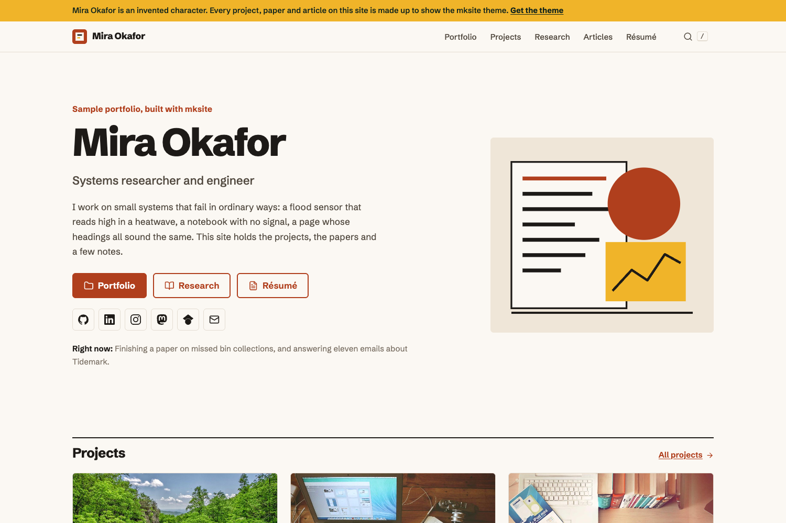

# mksite



A free Hugo theme for product pages and documentation. Made by [Conan Zhang](https://czt.sh) under the [ProjectOpenCZTSH](https://open.czt.sh) Initiative.

- Project page: https://mksite.czt.sh
- Demo: https://demo.mksite.czt.sh
- Guide: https://docs.open.czt.sh/mksite/

## What you get

- A home page set from front matter: headline, buttons, three features, free text.
- A plain page layout for About, Privacy and similar pages.
- A documentation layout with a sidebar, a table of contents, next and previous links, and a button back to the product page.
- Shortcodes: `button`, `callout`, `steps`, `kbd`, `pdf`.
- Portfolio mode: projects, research and articles, connected work, a timeline with CSS-only filters, search, four colour palettes and dark mode.
- A PDF reader that runs from your own site (pdf.js, Apache-2.0, in `static/vendor/pdfjs/`), with selectable text and a download button.
- Research pages carry Google Scholar tags, a BibTeX box and ScholarlyArticle data.
- Title, description, canonical link, Open Graph and JSON-LD.
- No tracking and no fonts from other servers. JavaScript is used only for search, copy buttons, the colour switcher and the PDF reader.

Needs Hugo 0.146 or newer.

## Use it

```bash
hugo new site my-site && cd my-site
git clone https://github.com/conanzhangtech/mksite themes/mksite
cp -r themes/mksite/starter/* . && cp -r themes/mksite/archetypes .
hugo server
```

Then add work with `hugo new projects/my-app`, `hugo new research/my-paper` or `hugo new articles/my-note`. The full guide is at https://docs.open.czt.sh/mksite/.

## Folders

| Folder | What it holds |
| --- | --- |
| `layouts/` | Templates, partials and shortcodes |
| `assets/css/` | The stylesheet |
| `static/` | The font and the `_headers` file for Cloudflare |
| `starter/` | A small site to copy and edit |
| `archetypes/` | Templates for `hugo new` |
| `exampleSite/` | The demo site at demo.mksite.czt.sh |
| `landing/` | The product page at mksite.czt.sh |

To preview either site from this folder: `hugo server --source exampleSite --themesDir ../..`

## Support

mksite is free and has no adverts. If it helps you, see the support options at https://open.czt.sh/#support.

## Licence

MIT. See `LICENSE`. The bundled pdf.js is Apache-2.0; its licence is in `static/vendor/pdfjs/LICENSE`.
