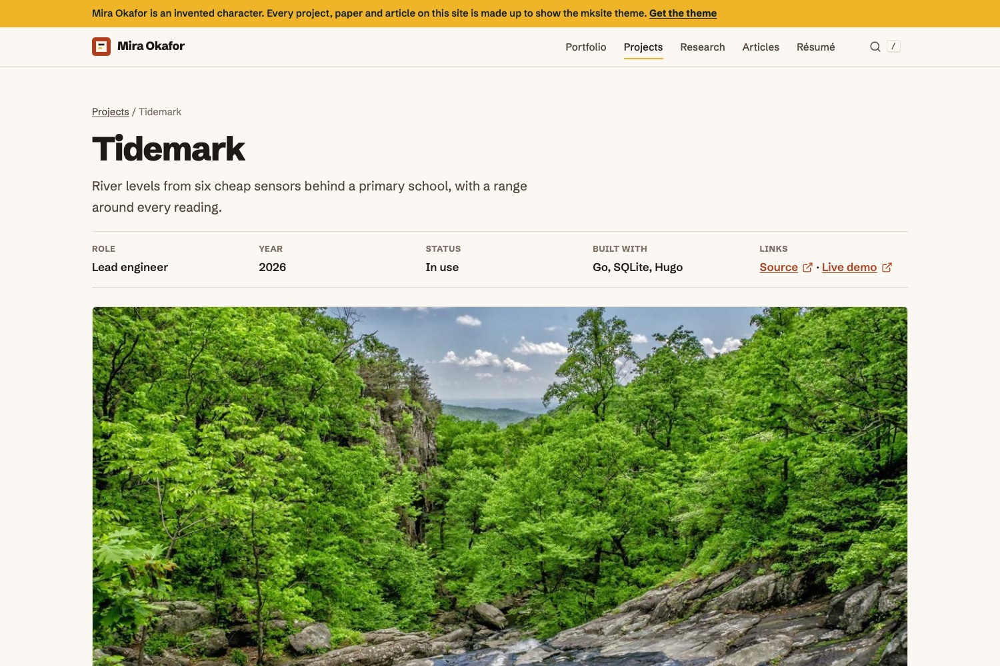
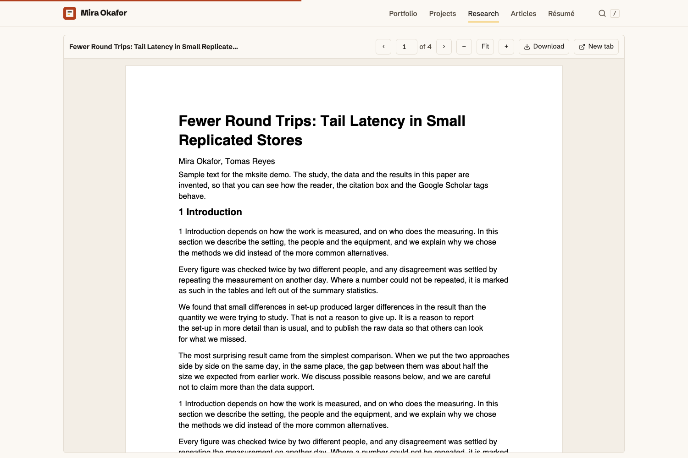
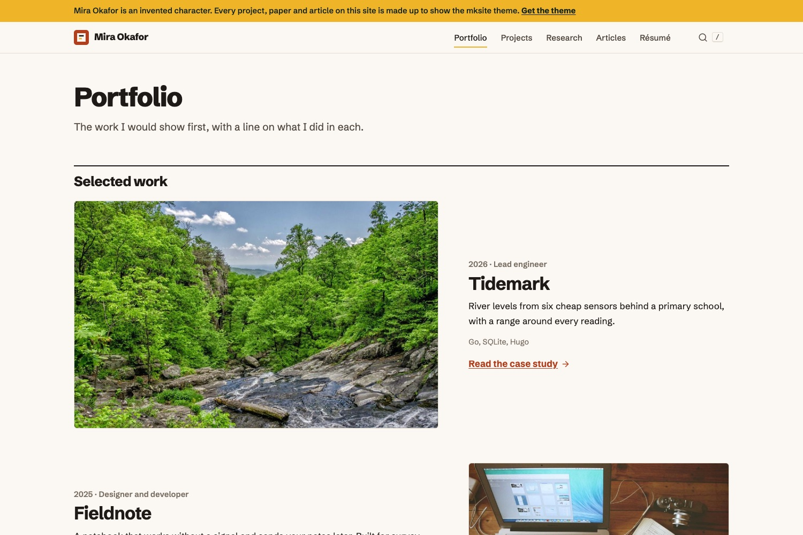
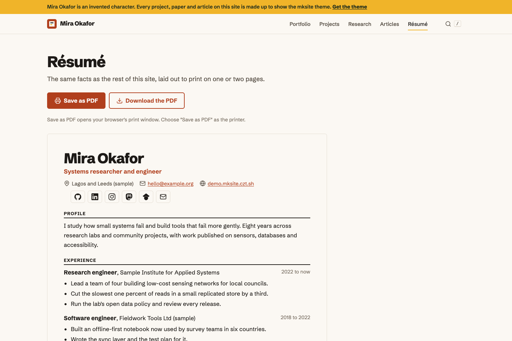
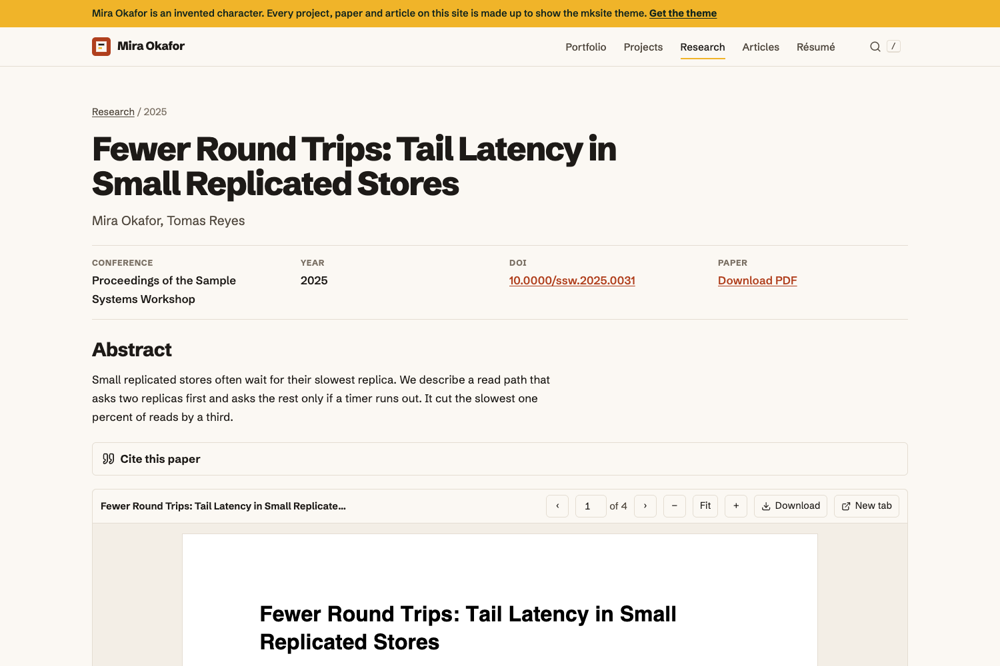
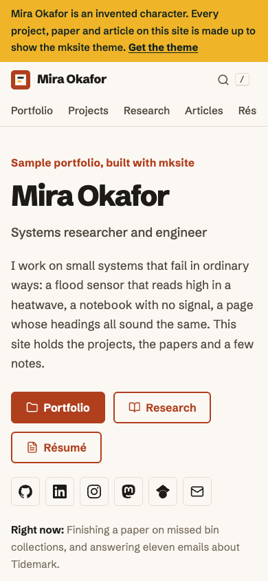

# mksite

[](LICENSE) [](https://gohugo.io) [](https://github.com/sponsors/conanzhangtech)

**Write Markdown files. Get a website.** mksite is a free Hugo theme for portfolios, research papers, product pages and documentation. Papers open in a PDF reader on the page, and your résumé prints to PDF.

[**Live demo**](https://demo.mksite.czt.sh) · [Guide](https://docs.open.czt.sh/mksite/) · [Project page](https://mksite.czt.sh)


## Quick start

You need [Hugo](https://gohugo.io/installation/) 0.146 or newer and Git.

```bash
hugo new site my-site && cd my-site
git clone https://github.com/conanzhangtech/mksite themes/mksite
cp -r themes/mksite/starter/* . && cp -r themes/mksite/archetypes .
hugo server
```

Open the address Hugo prints. Then add your own work:

```bash
hugo new projects/my-app
hugo new research/my-paper
hugo new articles/what-i-learned
```

Each command makes a folder with the right fields inside. Put a `cover.jpg` in a project or article for a picture, or a `.pdf` in a research folder for the reader.

## What you get

| | |
| --- | --- |
| **Projects** | Cards with a cover picture, a facts row and links. Projects, papers and articles can point to each other. |
| **Research** | A PDF reader on the page, a "Cite this paper" box with BibTeX, and the tags Google Scholar reads. |
| **Articles** | Reading time, a progress bar and thumbnails. |
| **Résumé** | Built from your front matter and the rest of the site. Prints to A4 or saves as PDF. |
| **Portfolio page** | Case studies, services, highlights and a contact band. |
| **Search** | Press `/` anywhere. No server needed. |
| **Look** | Four colour palettes, dark mode, social links as icons, 37 built-in icons. |
| **Docs mode** | Sidebar, table of contents, next and previous links, and a button back to the product page. |
| **Privacy** | No tracking and no fonts from other servers. JavaScript only for search, copy buttons, the colour switcher and the PDF reader. |

## Screenshots

| Project | Research with the PDF reader |
| --- | --- |
|  |  |

| Portfolio | Résumé |
| --- | --- |
|  |  |

| Research list | On a phone |
| --- | --- |
|  |  |

## Folders

| Folder | What it holds |
| --- | --- |
| `layouts/`, `assets/`, `static/` | The theme itself |
| `starter/` | A small site to copy and edit |
| `archetypes/` | The templates behind `hugo new` |
| `exampleSite/` | The demo at demo.mksite.czt.sh |
| `landing/` | The project page at mksite.czt.sh |

To preview the demo from this folder: `hugo server --source exampleSite --themesDir ../..`

## Support

mksite is free and has no adverts. If it saved you time, you can say thanks:

| Way to give | Link | Notes |
| --- | --- | --- |
| GitHub Sponsors | [github.com/sponsors/conanzhangtech](https://github.com/sponsors/conanzhangtech) | Monthly or one-off |
| Ko-fi | [ko-fi.com/conanzhangtech](https://ko-fi.com/conanzhangtech) | A one-off tip, no account needed |
| PayPal | [paypal.me/conanzhangtech](https://paypal.me/conanzhangtech) | Any amount |

**Crypto (USDT).** Send only on the network named in the table. Coins sent on another network cannot be recovered. Check the first and last few characters of the address before you send.

| Network | Address | QR code |
| --- | --- | --- |
| Ethereum (ERC-20) | `0x8Cc894EED2c98BEFB42477fd15868f59fa7D9C16` |  |
| Tron (TRC-20) | `TGHTXkjC8CpdLHF5g2m2RVsZ5QgzhyDWFi` |  |

More ways to give are on the [support page](https://open.czt.sh/#support). Starring the repository and telling a friend help too.

## Licence

MIT. See `LICENSE`. The bundled pdf.js is Apache-2.0; its licence is in `static/vendor/pdfjs/LICENSE`.

Made by [Conan Zhang](https://czt.sh) under the [ProjectOpenCZTSH](https://open.czt.sh) Initiative.
